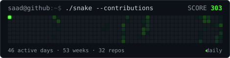

<div align="center">


<p>


</p>

</div>

## `$ neofetch`

<p align="center">

</p>

## `$ ls -la ~/projects`

`001` **AuraLearn** <br>├── AI SaaS LMS with voice tutors and subscription billing.<br>└── `Next.js` `Supabase` `VAPI` · [live](https://aura-learn-six.vercel.app/) · [src](https://github.com/AlphaBeast97/AuraLearn)

`002` **MAD Researcher** <br>├── Multi-agent research engine that plans, searches, and writes cited reports.<br>└── `React` `Node.js` `MongoDB` · [live](https://mad-researcher-web.onrender.com/) · [src](https://github.com/AlphaBeast97/deep-research-ai-platform)

`003` **RelayIt** <br>├── Video conferencing with recordings and multiple layouts.<br>└── `Next.js` `Stream` `Clerk` · [live](https://relayit.vercel.app/) · [src](https://github.com/AlphaBeast97/RelayIt)

`004` **Raabta** <br>├── Real-time chat with voice notes and media sharing.<br>└── `React` `Socket.io` `MongoDB` · [live](https://raabta-mm3a.onrender.com/) · [src](https://github.com/AlphaBeast97/raabta)

`005` **Culinary Canvas** <br>├── AI recipes from photos or ingredients.<br>└── `Next.js` `Gemini` `MongoDB` · [live](https://mega-project-livid.vercel.app/) · [src](https://github.com/AlphaBeast97/MegaProject)

## `$ tree ~/stack`

<p align="center">

</p>

<p align="center">

</p>

## `$ ./stats --user AlphaBeast97`

<div align="center">


</div>

<div align="center">

</div>

## `$ contact --list`

<div align="center">

[](https://github.com/AlphaBeast97) [](https://www.linkedin.com/in/saad-khan-4213a9284/) [](mailto:ksaad5272@gmail.com)

</div>

<div align="center">

</div>

```console
saad@github:~$ exit
logout
Connection to github.com closed.
[process completed]
```
