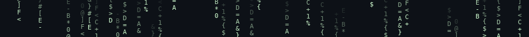
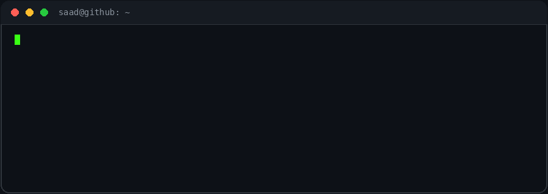
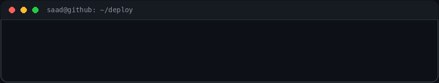

<div align="center">





<p>


</p>

</div>

## `$ neofetch`


```console
saad@github
-----------
role    : Full-Stack Developer
focus   : AI · real-time · infra
stack   : Next.js · TypeScript · Node.js
data    : MongoDB · Supabase
ships   : Docker · Vercel · Render
status  : building something useful
```

<br clear="all" />

## `$ ls -la ~/projects`

| PID | PROCESS | WHAT IT DOES | STACK | LINKS |
|:---:|:---|:---|:---|:---|
| `001` | **AuraLearn** | AI-powered SaaS LMS with voice-based tutors, multi-subject support, and subscription billing. | `Next.js` `Supabase` `Clerk` `VAPI` | [live](https://aura-learn-six.vercel.app/) · [src](https://github.com/AlphaBeast97/AuraLearn) |
| `002` | **MAD Researcher** | Multi-agent deep-research engine that plans, searches, reads, critiques, and writes cited reports. | `React` `Node.js` `MongoDB` `Clerk` | [live](https://mad-researcher-web.onrender.com/) · [src](https://github.com/AlphaBeast97/deep-research-ai-platform) |
| `003` | **RelayIt** | Full-stack video conferencing with instant meetings, scheduling, recordings, and multiple layouts. | `Next.js` `Stream` `Clerk` | [live](https://relayit.vercel.app/) · [src](https://github.com/AlphaBeast97/RelayIt) |
| `004` | **Raabta** | Real-time chat with voice notes, media sharing, themes, wallpapers, and dark mode. | `React` `Socket.io` `MongoDB` `Docker` | [live](https://raabta-mm3a.onrender.com/) · [src](https://github.com/AlphaBeast97/raabta) |
| `005` | **Culinary Canvas** | AI recipe platform with image-to-recipe, ingredient-based generation, and random discovery. | `Next.js` `Gemini` `n8n` `MongoDB` | [live](https://mega-project-livid.vercel.app/) · [src](https://github.com/AlphaBeast97/MegaProject) |

## `$ tree ~/stack`

```console
~/stack
├── frontend  → nextjs · react · typescript · tailwind
├── backend   → nodejs · express · mongodb · supabase
├── ai        → gemini · vapi · n8n · stream
└── infra     → docker · vercel · render · clerk
```

<p align="center">

</p>

## `$ ./stats --user AlphaBeast97`

<div align="center">


</div>

<div align="center">

</div>

## `$ contact --list`

<div align="center">

[](https://github.com/AlphaBeast97) [](https://www.linkedin.com/in/saad-khan-4213a9284/) [](mailto:ksaad5272@gmail.com)

</div>

<details>
<summary><code>$ sudo rm -rf doubts</code></summary>
<br />

Permission granted. If you have an interesting problem — AI, real-time, or infra — my inbox is open.

</details>

```console
saad@github:~$ exit
logout
Connection to github.com closed.
[process completed]
```
